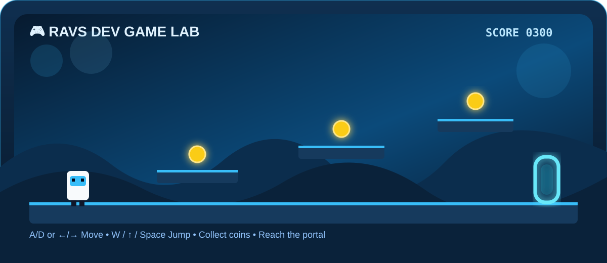

<div align="center">


# `RAVS DEV`

### `BACKEND DEVELOPER • GAME DEVELOPER • SERVER DEVELOPER`


<br>

<a href="https://github.com/Ravs-Dev"></a>


<br><br>


</div>

---

## `⟨ DEVELOPER PROFILE :: RAVS DEV ⟩`

<table>
<tr>
<td width="58%" valign="top">

### 👨‍💻 About Me

I'm **Ravs-Dev**, focused on building backend architecture, multiplayer game systems, web applications, Android projects, databases, and Linux/VPS infrastructure.

My main development areas:

- 🎮 Game Development
- ⚙️ Backend Development
- 🌐 Web Development
- 📱 Android Development
- 🗄️ Database Systems
- 🖥️ Linux / VPS
- 🚀 Multiplayer Roleplay Systems

> `Build • Learn • Improve • Repeat`

</td>
<td width="42%" valign="top">

### ⚡ Developer Status

```text
USER       : Ravs-Dev
STATUS     : ONLINE
MODE       : DEVELOPMENT
FOCUS      : GAME + BACKEND
STACK      : FULL SYSTEMS
MISSION    : BUILD BETTER
```

</td>
</tr>
</table>

---

# `⟨ TECHNOLOGY ARSENAL :: DEVELOPMENT STACK ⟩`

## `◈ PROGRAMMING LANGUAGES`

<div align="center">


<br><br>


</div>

---

## `◈ CORE LANGUAGES`

<div align="center">


<br>


</div>

---

## `◈ GAME DEVELOPMENT`

<div align="center">


<br><br>


</div>

---

## `◈ WEB DEVELOPMENT`

<div align="center">


<br><br>


</div>

---

## `◈ BACKEND DEVELOPMENT`

<div align="center">


<br><br>


</div>

---

## `◈ DATABASE`

<div align="center">


<br><br>


</div>

---

## `◈ MOBILE DEVELOPMENT`

<div align="center">


<br><br>


</div>

---

## `◈ SYSTEM & SERVER`

<div align="center">


<br><br>


</div>

---

## `◈ DEVELOPMENT TOOLS`

<div align="center">


<br><br>


</div>

---

# `⟨ PROJECT SHOWCASE :: ACTIVE BUILDS ⟩`

<table>
<tr>
<td width="50%" valign="top">

### 🎮 Aceh Open World

C++ / Unreal Engine open-world project with story, multiplayer architecture, gameplay systems, and dedicated-server planning.

<a href="https://github.com/Ravs-Dev/Game-Sendiri"></a>

</td>
<td width="50%" valign="top">

### 🌆 LineCity Roleplay

FiveM/QBCore roleplay development with custom resources, UI systems, database integration, jobs, inventory, phone and server systems.

<a href="https://github.com/Ravs-Dev/Grand-Country"></a>

</td>
</tr>
<tr>
<td width="50%" valign="top">

### 🕹️ Gamemode OpenMP

SA-MP/open.mp multiplayer gamemode work using PAWN and roleplay systems.

<a href="https://github.com/Ravs-Dev/Gamemode-OpenMp"></a>

</td>
<td width="50%" valign="top">

### 🌐 Web Belajar Coding

Programming learning web project with coding examples and a developer-oriented interface.

<a href="https://github.com/Ravs-Dev/Web-Belajar-Coding"></a>

</td>
</tr>
</table>

---

# `⟨ GAME LAB :: PLAYABLE PROFILE GAME ⟩`

<div align="center">

## 🎮 RAVS DEV — PORTAL RUN



<br><br>

`MISSION: Collect 3 coins → unlock portal → finish the level`

<br>


</div>

---

<details open>
<summary><b>▶ START GAME</b></summary>

<br>

```text
╭──────────────────────────────────────────────────────────────────╮
│ RAVS DEV GAME LAB                                   SCORE: 0000 │
├──────────────────────────────────────────────────────────────────┤
│                                                                  │
│   PLAYER                                                         │
│     ▣                                                            │
│                                                                  │
│ ═══════      🪙        ═══════      🪙       ═══════      🪙   🌀 │
│  START                                                PORTAL      │
│                                                                  │
│ OBJECTIVE: Collect all coins, then enter the portal.              │
╰──────────────────────────────────────────────────────────────────╯
```

### 🎮 CONTROLS

<details>
<summary><b>⬅️ MOVE LEFT</b></summary>

```text
PLAYER moved left.

Nothing found here.

Hint:
The first coin is on the RIGHT.
```

</details>

<details>
<summary><b>➡️ MOVE RIGHT — COLLECT COIN 1</b></summary>

```text
╭────────────────────────────────────────────────────────────╮
│ SCORE: 0100                                                │
│                                                            │
│            PLAYER                                          │
│              ▣                                             │
│ ═══════     [✓]       ═══════      🪙      ═══════    🪙 🌀 │
│             COIN 1                                         │
╰────────────────────────────────────────────────────────────╯

✓ COIN 1 COLLECTED
```

### NEXT MOVE

<details>
<summary><b>⬆️ JUMP — COLLECT COIN 2</b></summary>

```text
╭────────────────────────────────────────────────────────────╮
│ SCORE: 0200                                                │
│                                                            │
│                         PLAYER                             │
│                           ▣                                │
│ ═══════     [✓]       ═══════     [✓]      ═══════    🪙 🌀 │
│                                  COIN 2                    │
╰────────────────────────────────────────────────────────────╯

✓ COIN 2 COLLECTED
```

### NEXT MOVE

<details>
<summary><b>➡️ RUN RIGHT — COLLECT COIN 3</b></summary>

```text
╭────────────────────────────────────────────────────────────╮
│ SCORE: 0300                                                │
│                                                            │
│                                           PLAYER           │
│                                             ▣              │
│ ═══════     [✓]       ═══════     [✓]      ═══════   [✓] 🌀 │
│                                                     COIN 3 │
╰────────────────────────────────────────────────────────────╯

✓ COIN 3 COLLECTED
⚡ PORTAL UNLOCKED
```

### FINAL MOVE

<details>
<summary><b>🌀 ENTER PORTAL</b></summary>

```text
╔══════════════════════════════════════════════════════════╗
║                                                          ║
║                 MISSION COMPLETE                         ║
║                                                          ║
║                   SCORE: 0800                            ║
║                                                          ║
║              RAVS DEV GAME LAB                           ║
║                                                          ║
║                   YOU WIN!                               ║
║                                                          ║
╚══════════════════════════════════════════════════════════╝
```

🏆 **LEVEL COMPLETED**

</details>

</details>

<details>
<summary><b>⬇️ DROP DOWN</b></summary>

```text
You fell from the platform.

❤️ ❤️

Checkpoint restored.

Try:
⬆️ JUMP
```

</details>

</details>

</details>

---

<div align="center">

### `PROFILE GAME CONTROLS`

`⬅ LEFT` • `➡ RIGHT` • `⬆ JUMP` • `⬇ DROP` • `🌀 PORTAL`

<sub>Interactive GitHub README mode — click each control to progress through the game.</sub>

</div>

---

# `⟨ GITHUB ANALYTICS :: DEVELOPMENT DATA ⟩`

<div align="center">


<br>


</div>

---

# `⟨ ACTIVITY MATRIX :: CONTRIBUTION GRAPH ⟩`

<div align="center">


</div>

---

# `⟨ DEVELOPMENT CONSOLE :: SYSTEM STATUS ⟩`

```text
ravs@github:~$ system-status

GAME DEVELOPMENT ............. ONLINE
BACKEND DEVELOPMENT .......... ONLINE
DATABASE ..................... ONLINE
WEB DEVELOPMENT .............. ONLINE
ANDROID DEVELOPMENT .......... ONLINE
SERVER INFRASTRUCTURE ........ ONLINE

> SYSTEM READY.
```

---

<div align="center">

## `NEED A DEVELOPER?`

**Backend • Game Servers • FiveM • open.mp • Web • Android**

<a href="https://github.com/Ravs-Dev"></a>


<br><br>

`[ RAVS DEV ] • [ DEVELOPMENT NODE ONLINE ]`

</div>
